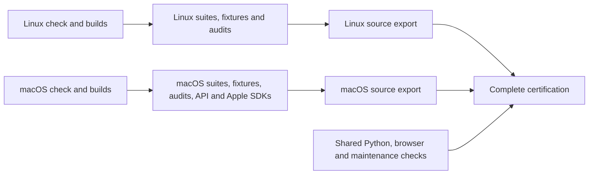

<!--
File: Docs/CI.md
Created by Carson Rau.
Copyright (c) 2026 Aurum Studios.
https://aurum-studios.com
-->

# Continuous validation and upstream review

The repository defines six workflow entry points: offline CI validation,
documentation publication, manual GitHub releases, weekly official upstream
review, manual controlled timing comparisons and periodic offline stress/soak.
CI also calls one reusable native-platform workflow, which has no push,
pull-request, schedule or manual trigger of its own.
A workflow definition does not establish that a hosted runner
has executed. Review actual artifacts before changing support claims.

## Offline validation

[Offline validation](../.github/workflows/ci.yml) runs on push, pull request and
manual dispatch with read-only repository permissions and no Discord secrets.
The workflow calls [the native-platform pipeline](../.github/workflows/native-platform.yml)
through two explicit jobs: **Linux x64** and **macOS ARM64**.
Windows CI is excluded because SwiftNIO does not support Windows.
Separate callers give each platform its own group in GitHub's job viewer, with
its own build, runtime-suite and compiler-fixture matrices. Each call owns its
platform check, plan, builds, runtime suites, compiler fixtures, validation and
source export. No platform waits for another platform's checks or builds:



| Target | Platform and runtime suite group | Build and compiler fixture group |
| --- | --- | --- |
| Linux x64 / Ubuntu 24.04 | `Linux-x64-8` | `Linux-x64-64` |
| macOS ARM64 / macOS 26 | `MacOS-26-5` | `MacOS-26-5` |

The `native-linux` and `native-macos` jobs each call one pipeline.
Each starts with exactly one check of the actual native OS, architecture,
Swift 6.4.1 compiler and target, then compiles, links and executes an offline
Foundation JSON roundtrip. A platform check is never multiplied by build
components, suites or runner sizes. Only that platform's check must pass before
its builds start. A failed or unfinished platform leaves the other pipeline
free to build, test, validate and export.
The macOS ARM pool has five cores and serves both compilation and runtime work.
Linux uses separate 64-core build and 8-core runtime pools.

After its platform check, a small native job evaluates the root manifest and plans
independent builds for the root, macros, extensions, tooling, load tools,
DSL benchmarks, shared timing support, instrumentation/Foundation/media timing
harnesses, consumers and optimized library products for that platform. Builds
use `swift build --build-tests` where applicable and do not execute test suites.
The DSL benchmark, load and timing harness builds also produce optimized smoke executables. Consumer
examples keep separate build directories so one example's metadata cannot
replace another example's test executable. Apple SDK module emissions run in
this build phase after the macOS platform check.

Every build for a platform must pass before that platform's test phase starts.
Apple SDK compilation does not gate runtime suites. Each root Swift test target
gets its own job; macro, extension, tooling, load and benchmark packages and
individual offline consumer examples have separate jobs. Runtime suites use
`swift test --skip-build --no-parallel`, and executable smoke tests use
`swift run --skip-build`. The helper compares restored test discovery with the
producer's nonempty inventory before executing a suite, and anchors root filters
to the exact module. Platform conditionals retain their existing behavior.

No current runtime suite has evidence requiring a large runner. Compiler fixture
suites are the exception: their positive and negative cases must invoke the
compiler, so each authoring fixture suite runs as a separate job on the build
pools. They still require the expected semantic diagnostics; infrastructure
crashes do not count as successful negative tests. Python tooling, load,
benchmark, shared timing support, Foundation timing and CI helpers and the browser bridge run as seven independent small
Linux jobs without native-build dependencies. Source audits run separately on
each platform and reuse its compiled tooling executable.
Public API and DocC checks reuse public symbol graphs emitted during the macOS
root and authoring builds, without recompiling stripped build artifacts.
The upstream maintenance freshness check remains a separate required job without
native-build dependencies. These shared checks gate overall certification;
platform exports depend on their own native validation.

The reusable workflow keeps all `needs` edges within one platform. The two
caller jobs have no dependencies on each other, so a failed pipeline cannot
cancel the other. Their internal matrices retain `fail-fast: false`.
GitHub groups reusable jobs under their caller; see
[reusable workflow navigation](https://github.blog/news-insights/product-news/improving-navigation-for-github-actions/)
and [calling reusable workflows](https://docs.github.com/en/actions/how-tos/reuse-automations/reuse-workflows#calling-a-reusable-workflow).

[The shared setup action](../.github/actions/setup-native/action.yml) installs
Swift 6.4.1, Python 3.12 and Node 24. Linux setup installs the Ubuntu prerequisites
and imports the official [Swift signing-key bundle](https://www.swift.org/keys/all-keys.asc)
with `curl --compressed` before invoking `setup-swift@v3`. It verifies the Swiftly
fingerprint `E813C892820A6FA13755B268F167DF1ACF9CE069`; installer and toolchain
signature verification remain enabled.
Every consumer job installs its matching compiler/runtime prerequisites too.

[The native job helper](../Tools/ci/native_jobs.py) transports each compilation in
a tar archive, retaining executable permissions, resources, symlinks and filenames
that cannot be uploaded individually. The archive receipt binds payload hashes,
tracked source contents, exact commit, workflow run and attempt, native platform,
compiler version/target, build engine and absolute checkout path. Consumers check
the whole archive before extraction and refuse mismatches or existing build
outputs. Compiled Swift tests embed absolute source paths, so each platform's
small and large runner images must provide the same checkout path and compatible
OS/SDK/runtime. A different path fails explicitly instead of silently rebuilding
on the small runner. Artifacts are local to the same workflow attempt and expire
after two days. Reruns must use **Re-run all jobs** so the new attempt produces
matching compilation artifacts.

All compile/test/run commands enforce committed dependency pins and explicit
positive job limits; the helper caps requests to CPUs visible to the process.
The native SwiftPM build engine is selected consistently in both producer and
consumer jobs. This avoids the SwiftBuild module-map registry crash observed in
[the failed Linux fixture run](https://github.com/Aurum-Studios/DiscordKit/actions/runs/42735757858/job/129564461315)
without accepting a crash as a semantic diagnostic or removing import checks.
Macro dependencies are compiled from source with
`--disable-experimental-prebuilts` to avoid
[SwiftPM prebuilt import-check false positives](https://github.com/swiftlang/swift-package-manager/issues/8798).
Use fresh build directories when changing this policy; an earlier prebuilt build
plan can retain the false-positive state.
The release graph policy also declares `Dispatch` specifically for
`DiscordTransport`, where timing uses `DispatchTime`, resolving the independently
observed import audit failure. These changes need a fresh hosted run for proof
on the pinned toolchain.

Build and test commands have finite process timeouts and durable progress logs.
POSIX execution terminates the child process group on failure or timeout. Each
job retains its own diagnostics even after failure. The final
**Offline certification passed** job runs with `always()` and requires both
platform pipelines, shared helper
suites and maintenance freshness to pass. Each pipeline has its own final gate
that rejects failed, cancelled or skipped required jobs; only the explicitly
macOS-only API/DocC and Apple SDK jobs may be skipped on Linux.

Each successful platform exports the clean source revision on push or manual
dispatch, even if another platform or a shared certification check fails. The
export waits for that platform's builds, runtime suites, compiler fixtures and
source audits; macOS also requires its API/DocC and Apple SDK checks. Pull requests
run the same validation without creating source bundles. Artifacts are named
`DiscordKit-<platform>-source-<revision>-<run>-<attempt>` and contain a SwiftPM
source archive, checksum and native compiler/host provenance. A platform export
records that platform's validation; release publication still requires complete
certification across all platforms and shared checks.

For local reproduction with the pinned compiler and native prerequisites:

```sh
python3 Tools/ci/platform_probe.py --platform linux-x64 --output .build/local-platform
python3 Tools/ci/native_jobs.py plan --platform linux-x64 --output .build/local-plan
python3 Tools/ci/native_jobs.py compile --platform linux-x64 --component root --jobs 8 \
  --output .build/local-build --archive /tmp/discordkit-root.tar.gz
# In a fresh checkout at the identical absolute path, using the same toolchain:
python3 Tools/ci/native_jobs.py test --platform linux-x64 --component root \
  --suite DiscordCoreTests --jobs 8 --output .build/local-test \
  --archive /tmp/discordkit-root.tar.gz
```

Choose the platform matching the current host and an appropriate job limit.
Omit `--platform` from `plan` to inspect the combined scheduling inventory locally.
[The legacy serial gate helper](../Tools/ci/linux_ci.py) remains available for
local whole-stage checks, including root, authoring, tooling, benchmarks, helpers,
audit, consumers and release. It uses the same pins and native build engine and
retains process cleanup and evidence. Its `--skip-preflight` remains restricted
to helper/audit stages. Cold setup and dependency resolution require network
access; the Discord workload itself is offline.

A runner inventory entry, queued job, local helper pass or workflow definition
is not hosted platform qualification. Review successful command logs and
artifacts at the actual revision. Native Windows named-pipe I/O, native audio,
minimum-OS runtime, physical devices, authorized Discord and production capacity
remain separate gates. Scheduling changes do not advance the maintenance ledger.
Documentation publication, manual releases and weekly upstream review retain
their separate workflows described below.

Checks cover typed arguments, command-family routing, response ownership,
message/mention safety, policies, bounded Gateway dispatch, supervised bot cleanup
and external module adoption. Separate macro tests compile expansions and external
positive/negative fixtures, including Sendable and dependency checks. Runtime
products never select SwiftSyntax or compiler plugins. Independent extension
libraries receive their own graph, public API and DocC checks.

The benchmark package has independent Swift/Python tests and a small paired
runtime smoke matrix. Full runtime/compiler measurements use explicit local
commands and are compared only with matching hardware, toolchain and workload.
API checks compare fresh compiler output to the applicable reviewed root, macro
and extension baselines; changing an existing baseline requires compatibility
review. None of these checks establishes publication or production capacity.

## Timing regression and periodic workloads

Start with the [measurement guide](Measurements.md) for workload selection,
compact report interpretation, compatible-host checks and the handoff ledger.
A compact summary is presentation of the original envelope, not a gate or new
baseline. Keep its uncertainty, loss and qualification notes with the numbers.

Ordinary native CI builds and tests `DiscordBenchmarkSupport`,
`DiscordTimingBenchmarks`, `DiscordFoundationBenchmarks` and
`DiscordMediaBenchmarks` independently. Their test discovery uses the same
nonempty exact-attempt compiled-artifact receipt as the existing suites. Seven
short release smoke cases cover disabled/aggregate/scalar instrumentation, a JSON
CPU batch, RTP roundtrip, scripted REST and actual local NIO HTTP. These commands
run with `--skip-build`, committed pins, finite operation and wall caps and a
120-second outer process-group timeout. Native/common reports must match, contain
successful nonempty populations, consistent finite histogram accounting, no
unknown dropped observations and awaited zero-owner cleanup. Counted histogram
underflow/overflow and sparse p99 remain visible. Shared-runner numerical values
are informational and have no latency or throughput regression budget. Smoke
reports and failure/partial logs expire after 14 days.

[Controlled timing comparison](../.github/workflows/timing-comparison.yml) is
manual only and has no dependency from ordinary CI. Select an existing isolated
runner group and matching native platform, then supply paths to a prepared
standard comparison spec and independent five-pair no-change series for the
**capture** stage. Prepare immutable baseline/candidate checkouts,
release receipts and fixtures outside the workflow checkout: checkout cleanup
must not remove those inputs. The spec identifies the actual controlled host,
contention, workload, warmup and duration chosen from a pilot. Both revisions
must already have pinned optimized receipts compatible with that host. The job
builds the current release evaluator, captures five fresh-process pairs in
counterbalanced order and emits immutable series plus canonical baseline/noise
hashes for review. Review workload-specific budgets against those exact frozen
reports, then invoke the separate **evaluate** stage with that same retained
series and the reviewed hash-bound policy. Evaluation never recaptures the
baseline: fresh timings would have different report hashes. Keep the captured
series outside the workflow checkout before a subsequent dispatch. Both stages
retain original inputs, per-run reports, process/host receipts and partial
failure evidence for 14 days. Missing, incompatible, contended or insufficient
evidence cannot silently pass. Numerical checks begin in the reviewed policy's
reporting mode; promoting a required workload gate requires a separate review.
The workflow never refreshes a baseline or rewrites a policy.

[Periodic offline stress, soak and integration](../.github/workflows/timing-periodic.yml)
runs weekly or by explicit manual invocation on the existing macOS ARM pool. The
stress job supervises three fresh instrumentation-contention processes at 4/8/16
workers, each with a 60-second measured cap. Operation limits can finish earlier;
the artifacts retain actual populations and elapsed time. The separate soak job
uses the existing cache/broadcast loop with 64 minimum rounds and 600 seconds of
minimum actual wall time, with bounded live cache/checkpoint state and joined
shutdown assertions. It preserves the legacy adapter's explicit unqualified
common envelope: this is continuity/resource evidence, not a timing baseline or
product SLO. The integration job runs the
[performance Phase 10](Tasks/performance-improvements/PHASE-10.md) mixed
request/cache/event workload for at least 1,800 measured seconds, repeating
independently scheduled load and recovery bands with the same retained owners.
It builds an independently receipt-bound common-schema validator and checks
duration, full terminal accounting, bounded cycle state, control progress,
resource ceilings and joined shutdown. A cap hit or shortened run fails integrity;
latency and throughput remain reporting only. Its 110-minute job ceiling includes
two bounded release builds and the soak. All three jobs use source/pin/executable-bound release receipts and the
shared supervisor's RSS, diagnostic, report and process ownership bounds. They
retain failures and partial results for 14 days and do not gate offline
certification. The helper is [timing_jobs.py](../Tools/ci/timing_jobs.py).

These workflow definitions have not been dispatched as part of Phases 10 or 11.
Hosted qualification requires completed runs at the exact implemented revision;
local synthetic tests and locally readable reports establish only their stated
offline scope.

The runtime API compatibility candidate is 0.20.0. Encoder injection adds the
`OpusPCMEncoding` contract, packet construction and timing diagnostics, and changes
the Voice initializers and error cases. These changes require an explicit pre-1.0
minor increment under the conservative source API policy. CI compares fresh graphs
against every retained baseline through 0.19.0; it does not replace the reviewed
0.19.0 baseline or its historical release evidence. The candidate version records
compatibility intent and makes no publication claim. The independently versioned
macro and extension comparisons remain at 0.15.0.

The `MacOS-26-5` group selects an arm64 host; the initial baseline is scoped to
arm64 macOS 13 module availability. If a runner architecture or platform scope
changes, the comparison must fail and receive review rather than resetting the
baseline silently. Compiler/SDK changes can also produce conservative differences.
The runtime and macro baselines were emitted locally with Apple Swift 6.4;
hosted CI requests Swift 6.4.1. The extensions 0.15.0 baseline has six reviewed
fingerprints updated from the run-bound Swift 6.4.1 graphs in
[CI run 43140630559](https://github.com/Aurum-Studios/DiscordKit/actions/runs/43140630559).
That compiler prints inferred `nonisolated(nonsending)` on three closure properties
and two initializers. It omits redundant `@escaping` in two initializer parameter
signatures and resolves
`Self` to `ExtensionArguments` in a static property's return type. All 86 symbols
and all relationships are retained. This is a reviewed compiler representation
update, not an API version increment or a compatibility qualification for other
toolchains. Isolation, parameter, availability and relationship changes remain
strictly fingerprinted; do not normalize them away or regenerate baselines to
hide unreviewed differences.

Every API comparison writes a JSON report containing its diff and admission
result, including semantic-version rejections. The job uploads available candidate
snapshots and reports as `api-diagnostics-<sha>-<run>-<attempt>` even after failure,
so a rejected comparison remains inspectable without rebuilding the compiler graph.
The separate macOS public API job uses restored public symbol graphs, compares the named platform API baseline,
and converts every owned public library's DocC archive with warnings as errors,
diagnostic analysis and experimental coverage. Each module receives its own primary
and extension graphs. Every product has authored guides and curated individual
type pages. The umbrella catalog supplies the package contents, learning paths,
twelve step-by-step tutorials and application recipes. Nonwriting checks reject
drift in compiler-derived type/member navigation and tutorial example snapshots.
The converter resolves cross-product links through local archive metadata and
merges all products into one `DiscordKitLibrary.doccarchive` navigator.
Archives and API evidence are downloadable workflow artifacts. The job publishes
artifacts only; it does not deploy documentation or publish a package/tag.
DocC public coverage cannot prove private declaration presence or accurate semantics.

A separate Apple job installs Swift 6.4.1, resolves the root's pinned SwiftLog checkout, then uses installed
Xcode SDKs to compile Logging, DiscordLogging, DiscordLogHandlers and Bits/Core/Transport/
Media/ApplePlatform in dependency order at package minima for macOS, iOS, tvOS, watchOS,
visionOS and their applicable simulators. The eight modules produce 72 emissions
across nine destinations, with source hashes including upstream Logging and its resolved revision. The Logging
emission uses its upstream concurrency settings; owned modules use the root settings.
`compile_apple.py` accepts `--scratch-path`, `--cache-path` and `--disable-sandbox`
for managed hosts and inherits the caller's environment. `--skip-resolve` uses an
existing checkout offline, requiring its SwiftPM state and Git revision to match
`Package.resolved`; missing sources fail. A missing SDK or compiler error fails the job. These are module emissions,
not a complete graph build, linked app, physical-device test, audio route test or
minimum-OS runtime result. The helper uses `swift` and `swiftc` from the selected
toolchain on `PATH`, and `xcrun` only locates SDKs from the selected Xcode. The compiler
must be Swift 6.4+ and Xcode must provide every named SDK; installation alone is never
recorded as a passed compile.

## Documentation website

The independent [Documentation workflow](../.github/workflows/documentation.yml)
runs on every push, pull request and manual dispatch, independently of offline
certification. A macOS ARM64 platform probe checks the host, compiler, linker and
runtime before three independent root, macro and extension compilation jobs.
Those jobs use the shared native setup and compile helper on `MacOS-26-5`, with
Swift 6.4.1, committed dependency pins, the native build engine, source-built
macro dependencies and a five-job limit capped at the available CPUs. They emit
normalized public symbol graphs and retain the same sealed compilation receipts
as offline certification. Compilation includes test executables and discovery;
the documentation workflow does not execute Swift test suites.

After all three builds pass, Python helper tests run on `Linux-x64-8` with
Python 3.12 while a macOS conversion job restores the three packages from this
workflow's exact commit, run and attempt. Restore checks source and payload
hashes, checkout path, platform and toolchain before accepting the artifacts.
The conversion job checks curation and tutorial snapshots, then converts the
root, macro and extension catalogs without emitting graphs or recompiling.
It uses the same strict DocC helper as offline certification. The workflow
retains platform, build, helper and conversion diagnostics for 14 days; compiled
packages expire after two days. Use **Re-run all jobs** for a fresh attempt.

[The site builder](../Tools/ci/build_documentation_site.py) merges those public
modules into one library navigator and exports static routes with the
repository name as the hosting base path. The root URL redirects to the merged
documentation landing page. The site is uploaded using GitHub's Pages artifact
action, which preserves DocC filenames containing colons inside a tar archive.
Generated website files remain build outputs and are not committed. The site
builder's `--skip-symbol-graphs` mode consumes the verified restored graphs and
fails if any public module is missing or malformed.

Only successful conversion and helper checks on the default branch can publish
[the website](https://aurum-studios.github.io/DiscordKit/). Pull requests and
other branches build an artifact without replacing the published site. The
deployment job alone receives `pages: write` and `id-token: write`, and uses the
`github-pages` environment. Deployments are serialized independently of CI;
default-branch runs are not canceled while publishing. A failed documentation
build leaves the previously deployed site available.

In the repository's **Settings > Pages**, the publishing source must be
**GitHub Actions**. No personal access token or additional repository secret is
required by the workflow. For a local build, run:

```sh
python3 Tools/ci/build_documentation_site.py --jobs 5 --hosting-base-path /DiscordKit
```

The output is `.build/documentation-site`. Change the base path for a different
repository name or use an empty base path when serving at a domain root. A
custom domain also requires updating `DOCUMENTATION_BASE_PATH` in the workflow.
Local builds refresh graphs with the native symbol-graph helper by default,
using the same pins, build engine and bounded compiler jobs. Documentation
success does not establish that independent build/test certification has passed.

## Manual GitHub releases

The [Release workflow](../.github/workflows/release.yml) runs only by manual
dispatch from the default branch. It accepts a chosen `Major.Minor.Build` version
and a full commit SHA, requires an existing successful **Offline certification**
run of [CI](../.github/workflows/ci.yml) at that exact commit from a push or manual
dispatch, including a successful **Offline certification passed** final gate in
that exact run attempt, then packages source and publishes a versioned tag and
GitHub release. Legacy runs without the final gate do not qualify. Publication
rechecks the recorded attempt and its final gate before creating a tag.
The target may be any commit present in the repository with that certification.
The workflow reuses certification evidence without repeating compilation or tests.

Both release jobs use `Linux-x64-8`, Python 3.12 and bash; preparation runs the
offline release helper tests before checking certification. Prepared assets are
named by target commit, workflow run and attempt. The preparation job has
`actions: read` and `contents: read`; only publication
receives `contents: write`. Reads use the standard `GITHUB_TOKEN`. For targets
that add or modify workflow files relative to the default branch, maintainers can
configure the optional `RELEASE_TOKEN` for publication with Contents and Workflows
write permissions; ordinary targets need no additional secret.
Publication is serialized per version without canceling a running
release, and existing tags or releases cannot be overwritten. See the
[release instructions](ReleaseTooling.md#manual-github-releases) for dispatch,
asset contents, qualification limits and recovery after an interrupted run.

## Weekly official review

[Weekly official upstream review](../.github/workflows/upstream-review.yml) runs each
Monday at 14:00 UTC and on manual dispatch. It fetches only the official Discord
documentation/specification Git repositories, compares their current heads to the
frozen discovery revisions, collects the current official change log, and publishes
exact refs, hashes, patches and a human-review reminder as artifacts and job summary.
It uses `Linux-x64-8`, Python 3.12 and bash, first testing baseline selection
offline. Collection verifies tracked source remains unchanged. Artifacts are
named by commit, run and attempt and retained for 14 days, including helper and
collection logs after failure. A newer run on the same ref cancels an older one.
Network/fetch failures fail collection. No API account is contacted, no issue/message
is sent, and no production source or verified-on date is changed automatically.

A maintainer reviews written-doc changes alongside stable/preview spec diffs,
classifies affected inventory rows, updates regression tests/docs/append-only history,
and records the actual semantic review and next due date in the maintenance ledger.
Automation does not satisfy that human review by itself. The release maintenance
validator rejects overdue reviews; before publishing, refresh affected source rows
and resolve unclassified entries. Preserve the original frozen discovery pins so
the review artifact remains reproducible and useful over time.
