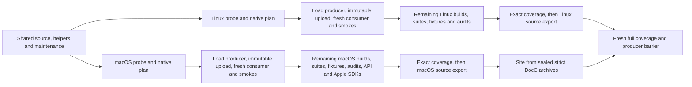

<!--
File: Docs/CI.md
Created by Carson Rau.
Copyright (c) 2026 Aurum Studios.
https://aurum-studios.com
-->

# Continuous validation and upstream review

The repository defines six workflow entry points: offline CI validation,
manual documentation requests, manual GitHub releases, weekly official upstream
review, manual controlled timing comparisons and periodic offline stress/soak.
CI also calls one reusable native-platform workflow, which has no push,
pull-request, schedule or manual trigger of its own.
A workflow definition does not establish that a hosted runner
has executed. Review actual artifacts before changing support claims.

The [CI reliability and spending plan](Tasks/ci-reliability/PLAN.md)
tracks cancellation repairs, bounded diagnostics, artifact recovery and staged
validation. Phase 0 retains a baseline and local planning policy with a
[zero-paid-execution sheet](Tasks/ci-reliability/BOOTSTRAP.md). The
[Phase 1 implementation and acceptance](Tasks/ci-reliability/phase-1/IMPLEMENTATION.md)
records local process-supervisor work. The
[Phase 2 repair and acceptance](Tasks/ci-reliability/phase-2/IMPLEMENTATION.md)
records event-hub benchmark accounting, deterministic cancellation regressions and
local Swift checks. Linux diagnosis, later scheduling changes and hosted
qualification remain tracked in the plan.

## Offline validation

[Offline validation](../.github/workflows/ci.yml) retains default-branch push, pull-request and
manual entry points with read-only permissions and no Discord secrets. The
[Phase 6 implementation](Tasks/ci-reliability/phase-6/IMPLEMENTATION.md) introduces
explicit `preflight`, `diagnostic` and `full` scope. The checked-in
[rollout setting](../Tools/ci/rollout.v1.json) selects **preflight** automatically
and keeps native expansion disabled for Phase 11 qualification. The
[Phase 10 admission policy](../Tools/ci/admission.v1.json) separately retains zero
allowances and unverified account pricing, so even helper fanout requires admission.
Manual full/diagnostic requests fail closed under these settings. Repository
variables or dispatch fields cannot grant paid execution. Documentation site preparation shares full CI inputs; Pages publication remains
contained behind full certification and an explicit publication request.

A source/policy/workflow job, four balanced Python/browser helper groups and the
independent human upstream-maintenance freshness check precede native scheduling.
Helpers use the process supervisor and a shared 300-second group deadline.
Source checks validate the reviewed manifest bytes/inventory and displayed
examples; actionlint verifies workflow syntax and expressions. Swift manifest
evaluation remains a native compiler operation. Compiled inventory/generation/
parity and documentation audits follow their own sufficient producer.

The prepared native graph retains two explicit, independent **Linux x64** and
**macOS ARM64** callers. Windows remains excluded. Its execution is contained;
this diagram describes the gated implementation, not hosted qualification:



| Target | Platform and runtime suite group | Build and compiler fixture group |
| --- | --- | --- |
| Linux x64 / Ubuntu 24.04 | `Linux-x64-8` | `Linux-x64-64`; tooling/timing-support use `Linux-x64-8` |
| macOS ARM64 / macOS 26 | `MacOS-26-5` | `MacOS-26-5` |

Each platform probes its actual OS, architecture, Swift 6.4.1 compiler/target and
runtime, then evaluates the root manifest against the reviewed source inventory.
Its load producer compiles tests and optimized smoke executables once, uploads
immutable bytes with producer provenance, and a separate consumer job resolves,
restores and compares complete nonempty discovery before running the entire load
package and existing REST/loopback smokes. Native receipt, source/path, digest,
discovery or timeout failure prevents only that platform's broader expansion.

The valid load build and complete suite are canonical once. Remaining matrices
exclude load; a diagnostic adds only its requested component/suite after the
explicit load canary prerequisite. No diagnostic automatically expands to full.
Root suites retain exact module filters and `--skip-build --no-parallel`;
compiler-positive/negative fixtures and native audits retain their existing work.
[Phase 7](Tasks/ci-reliability/phase-7/IMPLEMENTATION.md) replaces individual jobs
with four deterministic root groups, one batched consumer group and separate
package groups per platform (28 test groups total). Restore and discovery are
shared within each group; every whole root module retains its own bounded process.
Structured Swift Testing results must reconcile the selected producer leaves,
including the single predeclared optional MLS++ exclusion. Dedicated immutable
result artifacts are independently checked at each coverage barrier. XCTest
inventory fails explicitly pending a supported serial structured adapter.

The core producer wave unlocks root groups, tooling audits and API conversion
before remaining builds finish. Compiler waves and runtime group waves each cap
in-flight jobs at two. Compiler processes additionally obey policy, CPU affinity
and observed memory bounds. Tooling/timing-support initially use the existing
smaller Linux pool; their hosted capacity and measured savings remain pending.
Runtime group jobs allow 105 minutes and audits 60 minutes including bounded
restore/transfer reserves; per-suite process limits remain unchanged.

The expected-coverage manifest lists every probe, plan, producer, suite, fixture,
audit, API/Apple check and applicable export. Authenticated same-run API evidence
must contain each expected job and required step exactly once with successful
terminal results. Unexpected canonical build/test rows fail. A fresh full barrier
checks both platforms and every shared helper row and resolves both complete
producer indices again. Earlier successful same-run jobs may survive a partial
failed-job rerun; a newer failed/cancelled replacement cannot fall back to an old
success. Immutable producer attempts and selected job attempts stay recorded.

Only validated full scope creates **Offline certification passed**. Its required
`Verify full scope and complete coverage` step checks the full source-bound
manifest; release discovery requires that successful step too. Scoped runs use
**Preflight scope passed** or **Diagnostic scope passed**, including failure or
skip paths, and their scope-specific concurrency groups cannot supersede or
cancel full certification. Full runs still cancel superseded full runs.
Real GitHub context, branch-protection and fresh-runner/rerun acceptance remain
Phase 11 work before rollout.

[The shared setup action](../.github/actions/setup-native/action.yml) installs
Swift 6.4.1 and Python 3.12 with explicit `build` or `runtime` prerequisites.
Both profiles retain the full compiler and SwiftPM manifest linker dependencies;
only compiler/build jobs add the remaining development headers. Artifact and browser
helpers provision Node 24 where needed. Every caller caps the whole setup step at
ten minutes, including cache restore/save, with supervised prerequisite and installer
commands sharing the same allowance.

[Phase 8](Tasks/ci-reliability/phase-8/IMPLEMENTATION.md) caches only pinned official
Swift distributions, keyed by their hash, platform, exact image/SDK and versioned
installer policy. Every cold or hit path verifies SHA256 and the upstream signature
before fresh installation at the same path. Linux imports the official
[Swift signing-key bundle](https://www.swift.org/keys/all-keys.asc) with
`curl --compressed`, checking the required fingerprints in an isolated keyring;
macOS requires the exact Swift installer signer and trusted notarization.
Only default-branch pushes/manual runs may save entries. Corrupt, stale or
incompatible hits fail explicitly. Installed trees, credentials and build outputs
are excluded. Cache provenance stays informational; active compiler, image and SDK
must still satisfy the exact Phase 4 compatibility contract. Hosted cold/hit
timings and savings remain unmeasured.
Every consumer job installs its matching compiler/runtime prerequisites too.

[The native job helper](../Tools/ci/native_jobs.py) transports each compilation in
a tar archive, retaining executable permissions, resources, symlinks and filenames
that cannot be uploaded individually. The [version-2 receipt contract](Tasks/ci-reliability/phase-4/IMPLEMENTATION.md)
separates exact build compatibility from producer and consumer execution provenance.
Compatibility binds tracked source/commit, explicit pin digests, semantic build
commands/configuration, platform/architecture, compiler/target, native build engine,
canonical checkout path and exact OS/runtime/image/Xcode/SDK facts. Image release
URLs and runner names are informational. Producer records retain workflow/run/job/
attempt and trust scope, successful stages, inventory seal and timestamps. Consumers
retain their own identity, selected producer, archive digest, artifact identity,
discovery, selected suite and terminal results. Legacy v1 requires regeneration.

Consumers validate the entire payload and safe members/links before extraction and
refuse mismatches or existing build outputs. Compiled Swift tests embed absolute
source paths, so each platform's runner images must provide the same checkout path
and exact required OS/SDK/runtime inputs. A different path fails explicitly instead
of silently rebuilding. The native certification workflow now resolves an explicit
component index from successful producer jobs, immutable GitHub artifact IDs and
API SHA256 digests. Every consumer resolves again in its current job and records
its own attempt plus the selected producer attempt. An earlier successful attempt
is admitted only within this run, source revision, workflow and trust scope, after
exact compatibility, full archive and inventory checks. No matrix job output is
used as a component-to-artifact map.

**Re-run failed jobs** can reuse those successful producers without rebuilding.
Compiled artifacts and their producer receipts expire after two days; the planned
retry window is at most 48 hours and ends at actual API expiry. Missing/expired
artifacts require an explicitly scheduled fresh producer. An invalid selection,
changed image/path/compiler or corrupt archive fails closed. The latest platform
barrier checks the full producer index again. Real hosted rerun qualification
remains Phase 11 work; local helper evidence is recorded in the
[Phase 5 handoff](Tasks/ci-reliability/phase-5/IMPLEMENTATION.md).

[The transfer helper](../Tools/ci/artifact_transfer.py) retries classified transient
transport errors at most three times, with 120 seconds per attempt and 420 seconds
per aggregate operation. It uploads unchanged prepared bytes to immutable candidate
names, verifies final API identity/digest and never invokes tests or compilation.
Builds share one transfer budget for compiled payload plus producer sidecar, then
retain diagnostics through a separate bounded upload. Evidence failure fails its
owning job; it cannot be bypassed with `continue-on-error`. After runner disposal,
lost files need explicit regeneration. Documentation/API directories remain tarred
to preserve colon-containing names. Unix transport support covers the current
Linux/macOS callers; it adds no Windows qualification. The separate documentation
workflow now requests this same full CI graph manually, without separate builds.

All compile/test/run commands enforce committed dependency pins and explicit
positive job limits; the helper caps requests to CPUs visible to the process.
The native SwiftPM build engine is selected consistently in both producer and
consumer jobs. This avoids the SwiftBuild module-map registry crash observed in
[the failed Linux fixture run](https://github.com/Aurum-Studios/DiscordKit/actions/runs/42735757858/job/129564461315)
without accepting a crash as a semantic diagnostic or removing import checks.
Macro dependencies are compiled from source with
`--disable-experimental-prebuilts` to avoid
[SwiftPM prebuilt import-check false positives](https://github.com/swiftlang/swift-package-manager/issues/8798).
Use fresh build directories when changing this policy; an earlier prebuilt build
plan can retain the false-positive state.
The release graph policy also declares `Dispatch` specifically for
`DiscordTransport`, where timing uses `DispatchTime`, resolving the independently
observed import audit failure. These changes need a fresh hosted run for proof
on the pinned toolchain.

Native commands consume the shared scheduling policy's operation deadlines:
60 seconds for discovery, 300 for a compiled suite, 600 for whole load-package
confirmation, 120 for finite offline smokes and 1,200 per cold compilation
command. Serial compilation commands, symbol emission and package inventories
also have aggregate elapsed limits. Consumer compilation is capped at 5,400
seconds so discovery, archive/identity work and setup/diagnostic/cleanup/upload
reserves fit the existing two-hour build job. These caps do not establish
cold-build capacity. Archive/hash filesystem work remains subject to the
enclosing job timeout and explicit elapsed checks.

The POSIX supervisor owns the command process group and inherited output pipes.
It retains command receipts separately from machine-readable discovery stdout,
and cleans the group on failure or timeout. Bounded heartbeat, resource, process
and stack diagnostics record unavailable or denied probes explicitly. Diagnostic
work shares the execution deadline; silence is diagnostic evidence rather than
a deadlock verdict. Windows cleanup retains its best-effort helper coverage and
has no Windows qualification claim. Each job retains diagnostics even after
failure. The final
**Offline certification passed** job is available only for validated full scope.
It runs its fresh barrier with `always()`, requires both platform groups and all
shared checks, and rechecks the exact expected job/step coverage and producer
indices. Scoped runs create their own check context and cannot qualify a release.

In full mode, each successful platform exports the clean source revision on push
or manual dispatch, even if the other platform fails. Shared preflight must pass
before native scheduling. The
export waits for that platform's builds, runtime suites, compiler fixtures and
source audits; macOS also requires its API/DocC and Apple SDK checks. Pull requests
run the same validation without creating source bundles. Artifacts are named
`DiscordKit-<platform>-source-<revision>-<run>-<attempt>-t<transfer-attempt>` and contain a SwiftPM
source archive, checksum and native compiler/host provenance. A platform export
records that platform's validation; release publication still requires complete
certification across all platforms and shared checks.

For local reproduction with the pinned compiler and native prerequisites:

```sh
python3 Tools/ci/platform_probe.py --platform linux-x64 --output .build/local-platform
python3 Tools/ci/native_jobs.py plan --platform linux-x64 --output .build/local-plan
python3 Tools/ci/native_jobs.py compile --platform linux-x64 --component root --jobs 8 \
  --output .build/local-build --archive /tmp/discordkit-root.tar.gz
# In a fresh checkout at the identical absolute path, using the same toolchain:
python3 Tools/ci/native_jobs.py test --platform linux-x64 --component root \
  --suite DiscordCoreTests --jobs 8 --output .build/local-test \
  --archive /tmp/discordkit-root.tar.gz
```

Choose the platform matching the current host and an appropriate job limit.
Omit `--platform` from `plan` to inspect the combined scheduling inventory locally.
[The legacy serial gate helper](../Tools/ci/linux_ci.py) remains available for
local whole-stage checks, including root, authoring, tooling, benchmarks, helpers,
audit, consumers and release. It uses the same pins and native build engine and
retains process cleanup and evidence. Its `--skip-preflight` remains restricted
to helper/audit stages. Cold setup and dependency resolution require network
access; the Discord workload itself is offline.

A runner inventory entry, queued job, local helper pass or workflow definition
is not hosted platform qualification. Review successful command logs and
artifacts at the actual revision. Native Windows named-pipe I/O, native audio,
minimum-OS runtime, physical devices, authorized Discord and production capacity
remain separate gates. Scheduling changes do not advance the maintenance ledger.
Documentation publication, manual releases and weekly upstream review retain
their separate workflows described below.

Checks cover typed arguments, command-family routing, response ownership,
message/mention safety, policies, bounded Gateway dispatch, supervised bot cleanup
and external module adoption. Separate macro tests compile expansions and external
positive/negative fixtures, including Sendable and dependency checks. Runtime
products never select SwiftSyntax or compiler plugins. Independent extension
libraries receive their own graph, public API and DocC checks.

The benchmark package has independent Swift/Python tests and a small paired
runtime smoke matrix. Full runtime/compiler measurements use explicit local
commands and are compared only with matching hardware, toolchain and workload.
API checks compare fresh compiler output to the applicable reviewed root, macro
and extension baselines; changing an existing baseline requires compatibility
review. None of these checks establishes publication or production capacity.

## Timing regression and periodic workloads

Start with the [measurement guide](Measurements.md) for workload selection,
compact report interpretation, compatible-host checks and the handoff ledger.
A compact summary is presentation of the original envelope, not a gate or new
baseline. Keep its uncertainty, loss and qualification notes with the numbers.

Ordinary native CI builds and tests `DiscordBenchmarkSupport`,
`DiscordTimingBenchmarks`, `DiscordFoundationBenchmarks` and
`DiscordMediaBenchmarks` independently. Their test discovery uses the same
nonempty exact-attempt compiled-artifact receipt as the existing suites. Seven
short release smoke cases cover disabled/aggregate/scalar instrumentation, a JSON
CPU batch, RTP roundtrip, scripted REST and actual local NIO HTTP. These commands
run with `--skip-build`, committed pins, finite operation and wall caps and a
120-second outer process-group timeout. Native/common reports must match, contain
successful nonempty populations, consistent finite histogram accounting, no
unknown dropped observations and awaited zero-owner cleanup. Counted histogram
underflow/overflow and sparse p99 remain visible. Shared-runner numerical values
are informational and have no latency or throughput regression budget. Smoke
reports and failure/partial logs expire after 14 days.

[Controlled timing comparison](../.github/workflows/timing-comparison.yml) is
manual only and has no dependency from ordinary CI. Select an existing isolated
runner group and matching native platform, then supply paths to a prepared
standard comparison spec and independent five-pair no-change series for the
**capture** stage. Prepare immutable baseline/candidate checkouts,
release receipts and fixtures outside the workflow checkout: checkout cleanup
must not remove those inputs. The spec identifies the actual controlled host,
contention, workload, warmup and duration chosen from a pilot. Both revisions
must already have pinned optimized receipts compatible with that host. The job
builds the current release evaluator, captures five fresh-process pairs in
counterbalanced order and emits immutable series plus canonical baseline/noise
hashes for review. Review workload-specific budgets against those exact frozen
reports, then invoke the separate **evaluate** stage with that same retained
series and the reviewed hash-bound policy. Evaluation never recaptures the
baseline: fresh timings would have different report hashes. Keep the captured
series outside the workflow checkout before a subsequent dispatch. Both stages
retain original inputs, per-run reports, process/host receipts and partial
failure evidence for 14 days. Missing, incompatible, contended or insufficient
evidence cannot silently pass. Numerical checks begin in the reviewed policy's
reporting mode; promoting a required workload gate requires a separate review.
The workflow never refreshes a baseline or rewrites a policy.

[Periodic offline stress, soak and integration](../.github/workflows/timing-periodic.yml)
runs weekly or by explicit manual invocation on the existing macOS ARM pool. The
stress job supervises three fresh instrumentation-contention processes at 4/8/16
workers, each with a 60-second measured cap. Operation limits can finish earlier;
the artifacts retain actual populations and elapsed time. The separate soak job
uses the existing cache/broadcast loop with 64 minimum rounds and 600 seconds of
minimum actual wall time, with bounded live cache/checkpoint state and joined
shutdown assertions. It preserves the legacy adapter's explicit unqualified
common envelope: this is continuity/resource evidence, not a timing baseline or
product SLO. The integration job runs the
[performance Phase 10](Tasks/performance-improvements/PHASE-10.md) mixed
request/cache/event workload for at least 1,800 measured seconds, repeating
independently scheduled load and recovery bands with the same retained owners.
It builds an independently receipt-bound common-schema validator and checks
duration, full terminal accounting, bounded cycle state, control progress,
resource ceilings and joined shutdown. A cap hit or shortened run fails integrity;
latency and throughput remain reporting only. Its 110-minute job ceiling includes
two bounded release builds and the soak. All three jobs use source/pin/executable-bound release receipts and the
shared supervisor's RSS, diagnostic, report and process ownership bounds. They
retain failures and partial results for 14 days and do not gate offline
certification. The helper is [timing_jobs.py](../Tools/ci/timing_jobs.py).

These workflow definitions have not been dispatched as part of Phases 10 or 11.
Hosted qualification requires completed runs at the exact implemented revision;
local synthetic tests and locally readable reports establish only their stated
offline scope.

The runtime API compatibility candidate is 0.20.0. Encoder injection adds the
`OpusPCMEncoding` contract, packet construction and timing diagnostics, and changes
the Voice initializers and error cases. These changes require an explicit pre-1.0
minor increment under the conservative source API policy. CI compares fresh graphs
against every retained baseline through 0.19.0; it does not replace the reviewed
0.19.0 baseline or its historical release evidence. The candidate version records
compatibility intent and makes no publication claim. The independently versioned
macro and extension comparisons remain at 0.15.0.

The `MacOS-26-5` group selects an arm64 host; the initial baseline is scoped to
arm64 macOS 13 module availability. If a runner architecture or platform scope
changes, the comparison must fail and receive review rather than resetting the
baseline silently. Compiler/SDK changes can also produce conservative differences.
The runtime and macro baselines were emitted locally with Apple Swift 6.4;
hosted CI requests Swift 6.4.1. The extensions 0.15.0 baseline has six reviewed
fingerprints updated from the run-bound Swift 6.4.1 graphs in
[CI run 43140630559](https://github.com/Aurum-Studios/DiscordKit/actions/runs/43140630559).
That compiler prints inferred `nonisolated(nonsending)` on three closure properties
and two initializers. It omits redundant `@escaping` in two initializer parameter
signatures and resolves
`Self` to `ExtensionArguments` in a static property's return type. All 86 symbols
and all relationships are retained. This is a reviewed compiler representation
update, not an API version increment or a compatibility qualification for other
toolchains. Isolation, parameter, availability and relationship changes remain
strictly fingerprinted; do not normalize them away or regenerate baselines to
hide unreviewed differences.

Every API comparison writes a JSON report containing its diff and admission
result, including semantic-version rejections. The job uploads available candidate
snapshots and reports as `api-diagnostics-<sha>-<run>-<attempt>` even after failure,
so a rejected comparison remains inspectable without rebuilding the compiler graph.
The separate macOS public API job uses restored public symbol graphs, compares the named platform API baseline,
and converts every owned public library's DocC archive with warnings as errors,
diagnostic analysis and experimental coverage. Each module receives its own primary
and extension graphs. Every product has authored guides and curated individual
type pages. The umbrella catalog supplies the package contents, learning paths,
twelve step-by-step tutorials and application recipes. Nonwriting checks reject
drift in compiler-derived type/member navigation and tutorial example snapshots.
The converter resolves cross-product links through local archive metadata and
merges all products into one `DiscordKitLibrary.doccarchive` navigator.
Archives and API evidence are downloadable workflow artifacts. The job publishes
artifacts only; it does not deploy documentation or publish a package/tag.
DocC public coverage cannot prove private declaration presence or accurate semantics.

A separate Apple job installs Swift 6.4.1, resolves the root's pinned SwiftLog checkout, then uses installed
Xcode SDKs to compile Logging, DiscordLogging, DiscordLogHandlers and Bits/Core/Transport/
Media/ApplePlatform in dependency order at package minima for macOS, iOS, tvOS, watchOS,
visionOS and their applicable simulators. The eight modules produce 72 emissions
across nine destinations, with source hashes including upstream Logging and its resolved revision. The Logging
emission uses its upstream concurrency settings; owned modules use the root settings.
`compile_apple.py` accepts `--scratch-path`, `--cache-path` and `--disable-sandbox`
for managed hosts and inherits the caller's environment. `--skip-resolve` uses an
existing checkout offline, requiring its SwiftPM state and Git revision to match
`Package.resolved`; missing sources fail. A missing SDK or compiler error fails the job. These are module emissions,
not a complete graph build, linked app, physical-device test, audio route test or
minimum-OS runtime result. The helper uses `swift` and `swiftc` from the selected
toolchain on `PATH`, and `xcrun` only locates SDKs from the selected Xcode. The compiler
must be Swift 6.4+ and Xcode must provide every named SDK; installation alone is never
recorded as a passed compile.

## Documentation website

[Full CI](../.github/workflows/ci.yml) prepares the website from the same macOS
root, macro and extension producers used for API qualification. Each component
compiles and emits graphs in its existing producer; the public API job restores
those exact artifacts, preserves every API comparison, and performs strict
curation, tutorial checks and DocC conversion once. The
[Phase 9 implementation](Tasks/ci-reliability/phase-9/IMPLEMENTATION.md) records
local acceptance and its remaining hosted gates.

[Sealed conversion inputs](../Tools/ci/documentation_inputs.py) bind the exact
commit, tracked content, dependency pins, workflow/event/run/attempt, component,
strict conversion report, module inventory and every payload file hash. All three
inputs are uploaded together through bounded immutable transport. The read-only
site job authenticates the original successful producer by API and immutable
artifact ID/digest, verifies safe complete payloads, then merges and transforms
those archives without compiling, emitting graphs, curating or converting again.
An earlier successful same-run conversion may survive a partial rerun after fresh
selection; a newer failed replacement prevents fallback. Inputs expire after two
days and diagnostics after 14 days. Missing inputs require explicit regeneration.

The [site builder](../Tools/ci/build_documentation_site.py) preserves the combined
library navigator, repository hosting base path, static routes, root redirect and
hidden Pages marker. Site preparation is required by the fresh full certification
barrier. It uploads a seven-day immutable site archive using read-only repository
permissions; it has no Pages permission. The
[Documentation workflow](../.github/workflows/documentation.yml) has only a manual
trigger and requests the ordinary full CI workflow at the selected ref. It has no
separate compiler/conversion graph. Its own current-attempt spend guard precedes
dispatch; the checked-in zero allowance keeps requests contained.

Pages upload and deployment run in a separate job only when a manual request sets
`publish-documentation=true` (or selects `publish` in Documentation). The job
requires successful full certification, the trusted upstream default branch and
an exact current-attempt site. Its
[publication guard](../Tools/ci/documentation_publication.py) independently checks
the live repository/fork identity, default-branch tip, original CI workflow/event,
source revision, run attempt, successful exact full gate and site job/steps, and
immutable site artifact. PRs, diagnostics, stale/failed/incomplete runs and changed
artifacts cannot publish. Safe extraction admits only regular site files before
Pages upload. A deploy-only partial rerun requires a fresh site preparation and
full barrier for that attempt; old site outputs fail closed.

Only the publication job receives `pages: write` and `id-token: write`, preserves
the `github-pages` environment and serialized Pages concurrency, and can replace
[the website](https://aurum-studios.github.io/DiscordKit/). No `workflow_run`
publication path executes PR code with write privileges. Repository Pages settings
still require **GitHub Actions** as the publishing source. No deployment or setting
change occurred during Phase 9 implementation; hosted qualification remains Phase 11.

Local fresh documentation generation remains available:

```sh
python3 Tools/ci/build_documentation_site.py --jobs 5 --hosting-base-path /DiscordKit
```

A local consumer can instead repeat `--sealed-input` for the three sealed
component archives; CI additionally supplies a current immutable `--input-selection`.
The output remains `.build/documentation-site`. An empty base path serves a domain
root. Standalone local generation refreshes graphs and converts catalogs explicitly;
its success does not establish full certification or authorize publication.

## Manual GitHub releases

The [Release workflow](../.github/workflows/release.yml) runs only by manual
dispatch from the default branch. It accepts a chosen `Major.Minor.Build` version
and a full commit SHA, requires an existing successful **Offline certification**
run of [CI](../.github/workflows/ci.yml) at that exact commit from a push or manual
dispatch, including a successful **Offline certification passed** final gate in
that exact run attempt, then packages source and publishes a versioned tag and
GitHub release. Legacy runs without the final gate do not qualify. Publication
rechecks the recorded attempt and its final gate before creating a tag.
The target may be any commit present in the repository with that certification.
The workflow reuses certification evidence without repeating compilation or tests.

Both release jobs use `Linux-x64-8`, Python 3.12 and bash; preparation runs the
offline release helper tests before checking certification. Prepared assets are
named by target commit, workflow run and attempt. The preparation job has
`actions: read` and `contents: read`; only publication
receives `contents: write`. Reads use the standard `GITHUB_TOKEN`. For targets
that add or modify workflow files relative to the default branch, maintainers can
configure the optional `RELEASE_TOKEN` for publication with Contents and Workflows
write permissions; ordinary targets need no additional secret.
Publication is serialized per version without canceling a running
release, and existing tags or releases cannot be overwritten. See the
[release instructions](ReleaseTooling.md#manual-github-releases) for dispatch,
asset contents, qualification limits and recovery after an interrupted run.

## Weekly official review

[Weekly official upstream review](../.github/workflows/upstream-review.yml) runs each
Monday at 14:00 UTC and on manual dispatch. It fetches only the official Discord
documentation/specification Git repositories, compares their current heads to the
frozen discovery revisions, collects the current official change log, and publishes
exact refs, hashes, patches and a human-review reminder as artifacts and job summary.
It uses `Linux-x64-8`, Python 3.12 and bash, first testing baseline selection
offline. Collection verifies tracked source remains unchanged. Artifacts are
named by commit, run and attempt and retained for 14 days, including helper and
collection logs after failure. A newer run on the same ref cancels an older one.
Network/fetch failures fail collection. No API account is contacted, no issue/message
is sent, and no production source or verified-on date is changed automatically.

A maintainer reviews written-doc changes alongside stable/preview spec diffs,
classifies affected inventory rows, updates regression tests/docs/append-only history,
and records the actual semantic review and next due date in the maintenance ledger.
Automation does not satisfy that human review by itself. The release maintenance
validator rejects overdue reviews; before publishing, refresh affected source rows
and resolve unclassified entries. Preserve the original frozen discovery pins so
the review artifact remains reproducible and useful over time.

## Spend admission and usage

[Phase 10](Tasks/ci-reliability/phase-10/IMPLEMENTATION.md) expands the same platform
execution partitions used by CI and reads actual workflow deadlines, rather than
maintaining an approximate second build/test list. Each runner job and permitted
attempt reserves its whole outer envelope, including startup, provisioning,
commands, recovery, diagnostics, cleanup and uploads. Independent platform
reservations add to one workflow allowance. Rate/mapping uncertainty, stale dates,
unknown storage/transfer liability, excess cost or exhausted attempts reject work.

Every job checks current source, policy, scope, runner group and attempt after
minimal checkout and before provisioning. Partial consumer reruns cannot reuse a
successful earlier admission output or reset their allowance. The native rollout
remains closed independently. Pushes validate only the maintained default branch
`main`; PR and explicit manual runs remain, avoiding branch-push/PR duplicates.

The bootstrap and aggregation expose JSON and step summaries for planned maxima,
per-SKU rounded observed minutes, queue/setup/transfer evidence, command outcomes,
remaining coverage and admission reasons. Each native job retains its guard/local
summary with diagnostics. Unavailable billing mappings or unfinished jobs stay
unknown. Estimates are neither invoices nor exact provider-enforced dollar caps.
Checkout occurs before refusal, and the source guard cannot cap arbitrarily many
separately started rejected jobs or share allowance across workflow run IDs.

The [operator checklist](Tasks/ci-reliability/phase-10/OPERATOR-BUDGET.md) prepares a
concrete USD 50/month repository Actions backstop proposal with stop usage and
75/90/100 alerts. It awaits operator selection, explicit authorization and complete
read-back. No billing configuration or paid execution is claimed.
