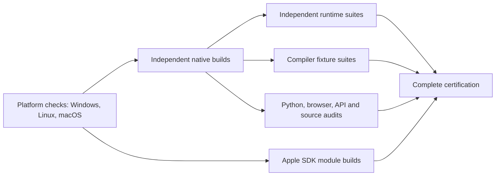

<!--
File: Docs/CI.md
Created by Carson Rau.
Copyright (c) 2026 Aurum Studios.
https://aurum-studios.com
-->

# Continuous validation and upstream review

The repository defines four workflows: offline CI validation, documentation
publication, manual GitHub releases and weekly official upstream review.
A workflow definition does not establish that a hosted runner
has executed. Review actual artifacts before changing support claims.

## Offline validation

[Offline validation](../.github/workflows/ci.yml) runs on push, pull request and
manual dispatch with read-only repository permissions and no Discord secrets.
The workflow follows the same compile-once, independent-suite pattern as
MiniCarson, with three native platforms:



| Target | Platform and runtime suite group | Build and compiler fixture group |
| --- | --- | --- |
| Linux x64 / Ubuntu 24.04 | `Linux-x64-8` | `Linux-x64-64` |
| Windows x64 | `Windows-x64-8` | `Windows-x64-64` |
| macOS ARM64 / macOS 26 | `MacOS-26-5` | `MacOS-26-5` |

The `platforms` matrix is the first group and contains exactly one Windows, one
Linux and one macOS check. Each verifies the actual native OS, architecture,
Swift 6.4.1 compiler and target, then compiles, links and executes an offline
Foundation JSON roundtrip. A platform check is never multiplied by build
components, suites or runner sizes. All three must pass before any build starts.
The macOS ARM pool has five cores and serves both compilation and runtime work.
Linux and Windows use separate 64-core build and 8-core runtime pools.

After platform checks, a small Linux job evaluates the root manifest and plans
independent builds for the root, macros, extensions, tooling, load tools,
benchmarks, consumers and optimized library products on each platform. Builds
use `swift build --build-tests` where applicable and do not execute test suites.
The benchmark build also produces its optimized smoke executable. Consumer
examples keep separate build directories so one example's metadata cannot
replace another example's test executable. Apple SDK module emissions run in
this build phase after the same platform barrier.

Every build must pass before the test phase starts. Each root Swift test target
gets its own job; macro, extension, tooling, load and benchmark packages and
individual offline consumer examples have separate jobs. Runtime suites use
`swift test --skip-build --no-parallel`, and executable smoke tests use
`swift run --skip-build`. The helper compares restored test discovery with the
producer's nonempty inventory before executing a suite, and anchors root filters
to the exact module. Windows omits the explicitly Unix-only test target.
Other platform conditionals retain their existing behavior.

No current runtime suite has evidence requiring a large runner. Compiler fixture
suites are the exception: their positive and negative cases must invoke the
compiler, so each authoring fixture suite runs as a separate job on the build
pools. They still require the expected semantic diagnostics; infrastructure
crashes do not count as successful negative tests. Python tooling, load,
benchmark and CI helpers and the browser bridge run as five independent small
Linux jobs. Source audits reuse the compiled Linux tooling executable.
Public API and DocC checks reuse public symbol graphs emitted during the macOS
root and authoring builds, without recompiling stripped build artifacts.
The upstream maintenance freshness check remains a separate required job.

[The shared setup action](../.github/actions/setup-native/action.yml) installs
Swift 6.4.1, Python 3.12 and Node 24. Linux setup installs the Ubuntu prerequisites
and imports the official [Swift signing-key bundle](https://www.swift.org/keys/all-keys.asc)
with `curl --compressed` before invoking `setup-swift@v3`. It verifies the Swiftly
fingerprint `E813C892820A6FA13755B268F167DF1ACF9CE069`; installer and toolchain
signature verification remain enabled. Windows enables long paths before
checkout, enables Developer Mode, requires MSVC x64 tools and Windows SDK
10.0.22000 or newer, and uses the pinned
[Swift installer action](https://github.com/compnerd/gha-setup-swift/tree/9ff1ee4c44888c5817fc14d1b257ac8cabb4935f).
Every consumer job installs its matching compiler/runtime prerequisites too.

[The native job helper](../Tools/ci/native_jobs.py) transports each compilation in
a tar archive, retaining executable permissions, resources, symlinks and filenames
that cannot be uploaded individually. The archive receipt binds payload hashes,
tracked source contents, exact commit, workflow run and attempt, native platform,
compiler version/target, build engine and absolute checkout path. Consumers check
the whole archive before extraction and refuse mismatches or existing build
outputs. Compiled Swift tests embed absolute source paths, so each platform's
small and large runner images must provide the same checkout path and compatible
OS/SDK/runtime. A different path fails explicitly instead of silently rebuilding
on the small runner. Artifacts are local to the same workflow attempt and expire
after two days. Reruns must use **Re-run all jobs** so the new attempt produces
matching compilation artifacts.

All compile/test/run commands enforce committed dependency pins and explicit
positive job limits; the helper caps requests to CPUs visible to the process.
The native SwiftPM build engine is selected consistently in both producer and
consumer jobs. This avoids the SwiftBuild module-map registry crash observed in
[the failed Linux fixture run](https://github.com/Aurum-Studios/DiscordKit/actions/runs/42735757858/job/129564461315)
without accepting a crash as a semantic diagnostic or removing import checks.
Macro dependencies are compiled from source with
`--disable-experimental-prebuilts` to avoid
[SwiftPM prebuilt import-check false positives](https://github.com/swiftlang/swift-package-manager/issues/8798).
Use fresh build directories when changing this policy; an earlier prebuilt build
plan can retain the false-positive state.
The release graph policy also declares `Dispatch` specifically for
`DiscordTransport`, where timing uses `DispatchTime`, resolving the independently
observed import audit failure. These changes need a fresh hosted run for proof
on the pinned toolchain.

Build and test commands have finite process timeouts and durable progress logs.
POSIX execution terminates the child process group on failure or timeout;
Windows uses regular-file logs and best-effort `taskkill /T /F`. Each job retains
its own diagnostics even after failure. The final **Offline certification passed**
job runs with `always()` and fails if any required platform, build, suite, audit,
Apple module build or packaging job failed, was cancelled or was skipped.
Only fully successful non-pull-request runs package the clean source revision
with checksums and native compiler/host metadata. This is a source archive, not
a published release or precompiled distribution.

For local reproduction with the pinned compiler and native prerequisites:

```sh
python3 Tools/ci/platform_probe.py --platform linux-x64 --output .build/local-platform
python3 Tools/ci/native_jobs.py plan --output .build/local-plan
python3 Tools/ci/native_jobs.py compile --platform linux-x64 --component root --jobs 8 \
  --output .build/local-build --archive /tmp/discordkit-root.tar.gz
# In a fresh checkout at the identical absolute path, using the same toolchain:
python3 Tools/ci/native_jobs.py test --platform linux-x64 --component root \
  --suite DiscordCoreTests --jobs 8 --output .build/local-test \
  --archive /tmp/discordkit-root.tar.gz
```

Choose the platform matching the current host and an appropriate job limit.
[The legacy serial gate helper](../Tools/ci/linux_ci.py) remains available for
local whole-stage checks, including root, authoring, tooling, benchmarks, helpers,
audit, consumers and release. It uses the same pins and native build engine and
retains process cleanup and evidence. Its `--skip-preflight` remains restricted
to helper/audit stages. Cold setup and dependency resolution require network
access; the Discord workload itself is offline.

A runner inventory entry, queued job, local helper pass or workflow definition
is not hosted platform qualification. Review successful command logs and
artifacts at the actual revision. Native Windows named-pipe I/O, native audio,
minimum-OS runtime, physical devices, authorized Discord and production capacity
remain separate gates. Scheduling changes do not advance the maintenance ledger.
Documentation publication, manual releases and weekly upstream review retain
their separate workflows described below.

Checks cover typed arguments, command-family routing, response ownership,
message/mention safety, policies, bounded Gateway dispatch, supervised bot cleanup
and external module adoption. Separate macro tests compile expansions and external
positive/negative fixtures, including Sendable and dependency checks. Runtime
products never select SwiftSyntax or compiler plugins. Independent extension
libraries receive their own graph, public API and DocC checks.

The benchmark package has independent Swift/Python tests and a small paired
runtime smoke matrix. Full runtime/compiler measurements use explicit local
commands and are compared only with matching hardware, toolchain and workload.
API checks compare fresh compiler output to the applicable reviewed root, macro
and extension baselines; changing an existing baseline requires compatibility
review. None of these checks establishes publication or production capacity.

The runtime API compatibility candidate is 0.20.0. Encoder injection adds the
`OpusPCMEncoding` contract, packet construction and timing diagnostics, and changes
the Voice initializers and error cases. These changes require an explicit pre-1.0
minor increment under the conservative source API policy. CI compares fresh graphs
against every retained baseline through 0.19.0; it does not replace the reviewed
0.19.0 baseline or its historical release evidence. The candidate version records
compatibility intent and makes no publication claim. The independently versioned
macro and extension comparisons remain at 0.15.0.

The `MacOS-26-5` group selects an arm64 host; the initial baseline is scoped to
arm64 macOS 13 module availability. If a runner architecture or platform scope
changes, the comparison must fail and receive review rather than resetting the
baseline silently. Compiler/SDK changes can also produce conservative differences.
The committed baselines were emitted locally with Apple Swift 6.4;
hosted CI requests Swift 6.4.1. A workflow definition does not demonstrate that
these toolchains emit identical signatures. Review actual same-version comparison
results before accepting hosted compatibility; do not regenerate a baseline to
hide compiler-driven differences.
The separate macOS public API job emits public symbol graphs, compares the named platform API baseline,
and converts every owned public library's DocC archive with warnings as errors,
diagnostic analysis and experimental coverage. Each module receives its own primary
and extension graphs. Every product has authored guides and curated individual
type pages. The umbrella catalog supplies the package contents, learning paths,
twelve step-by-step tutorials and application recipes. Nonwriting checks reject
drift in compiler-derived type/member navigation and tutorial example snapshots.
The converter resolves cross-product links through local archive metadata and
merges all products into one `DiscordKitLibrary.doccarchive` navigator.
Archives and API evidence are downloadable workflow artifacts. The job publishes
artifacts only; it does not deploy documentation or publish a package/tag.
DocC public coverage cannot prove private declaration presence or accurate semantics.

A separate Apple job installs Swift 6.4.1, resolves the root's pinned SwiftLog checkout, then uses installed
Xcode SDKs to compile Logging, DiscordLogging, DiscordLogHandlers and Bits/Core/Transport/
Media/ApplePlatform in dependency order at package minima for macOS, iOS, tvOS, watchOS,
visionOS and their applicable simulators. The eight modules produce 72 emissions
across nine destinations, with source hashes including upstream Logging and its resolved revision. The Logging
emission uses its upstream concurrency settings; owned modules use the root settings.
`compile_apple.py` accepts `--scratch-path`, `--cache-path` and `--disable-sandbox`
for managed hosts and inherits the caller's environment. `--skip-resolve` uses an
existing checkout offline, requiring its SwiftPM state and Git revision to match
`Package.resolved`; missing sources fail. A missing SDK or compiler error fails the job. These are module emissions,
not a complete graph build, linked app, physical-device test, audio route test or
minimum-OS runtime result. The helper uses `swift` and `swiftc` from the selected
toolchain on `PATH`, and `xcrun` only locates SDKs from the selected Xcode. The compiler
must be Swift 6.4+ and Xcode must provide every named SDK; installation alone is never
recorded as a passed compile.

## Documentation website

The independent [Documentation workflow](../.github/workflows/documentation.yml)
runs on every push, pull request and manual dispatch. Its build job has no
dependency on the offline certification jobs, so GitHub can schedule both
workflows at the same time. It uses the `MacOS-26-5` group and Swift 6.4.1 to emit public symbol
graphs, check curation and tutorial snapshots, and convert all root, macro and
extension library catalogs with the same strict DocC helper used by CI.

[The site builder](../Tools/ci/build_documentation_site.py) merges those public
modules into one library navigator and exports static routes with the
repository name as the hosting base path. The root URL redirects to the merged
documentation landing page. The site is uploaded using GitHub's Pages artifact
action, which preserves DocC filenames containing colons inside a tar archive.
Generated website files remain build outputs and are not committed.

Only a successful documentation build on the default branch can publish
[the website](https://aurum-studios.github.io/DiscordKit/). Pull requests and
other branches build an artifact without replacing the published site. The
deployment job alone receives `pages: write` and `id-token: write`, and uses the
`github-pages` environment. Deployments are serialized independently of CI;
default-branch runs are not canceled while publishing. A failed documentation
build leaves the previously deployed site available.

In the repository's **Settings > Pages**, the publishing source must be
**GitHub Actions**. No personal access token or additional repository secret is
required by the workflow. For a local build, run:

```sh
python3 Tools/ci/build_documentation_site.py --hosting-base-path /DiscordKit
```

The output is `.build/documentation-site`. Change the base path for a different
repository name or use an empty base path when serving at a domain root. A
custom domain also requires updating `DOCUMENTATION_BASE_PATH` in the workflow.
The documentation job compiles packages to emit symbol graphs; its success does
not establish that the independent build/test certification has passed.

## Manual GitHub releases

The [Release workflow](../.github/workflows/release.yml) runs only by manual
dispatch from the default branch. It accepts a chosen `Major.Minor.Build` version
and a full commit SHA, requires an existing successful **Offline certification**
run of [CI](../.github/workflows/ci.yml) at that exact commit from a push or manual
dispatch, then packages source and publishes a versioned tag and GitHub release.
The target may be any commit present in the repository with that certification.
The workflow reuses certification evidence without repeating compilation or tests.

The preparation job has `actions: read` and `contents: read`; only publication
receives `contents: write`. Reads use the standard `GITHUB_TOKEN`. For targets
that add or modify workflow files relative to the default branch, maintainers can
configure the optional `RELEASE_TOKEN` for publication with Contents and Workflows
write permissions; ordinary targets need no additional secret.
Publication is serialized per version without canceling a running
release, and existing tags or releases cannot be overwritten. See the
[release instructions](ReleaseTooling.md#manual-github-releases) for dispatch,
asset contents, qualification limits and recovery after an interrupted run.

## Weekly official review

[Weekly official upstream review](../.github/workflows/upstream-review.yml) runs each
Monday at 14:00 UTC and on manual dispatch. It fetches only the official Discord
documentation/specification Git repositories, compares their current heads to the
frozen discovery revisions, collects the current official change log, and publishes
exact refs, hashes, patches and a human-review reminder as artifacts and job summary.
Network/fetch failures fail collection. No API account is contacted, no issue/message
is sent, and no production source or verified-on date is changed automatically.

A maintainer reviews written-doc changes alongside stable/preview spec diffs,
classifies affected inventory rows, updates regression tests/docs/append-only history,
and records the actual semantic review and next due date in the maintenance ledger.
Automation does not satisfy that human review by itself. The release maintenance
validator rejects overdue reviews; before publishing, refresh affected source rows
and resolve unclassified entries. Preserve the original frozen discovery pins so
the review artifact remains reproducible and useful over time.
