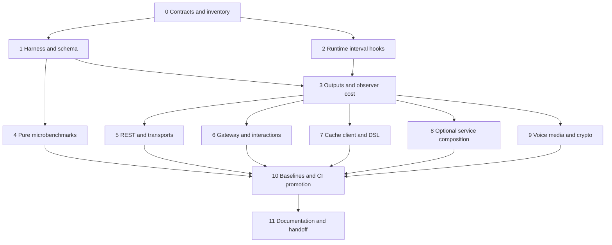

<!--
File: Docs/Tasks/latency-timing/PLAN.md
Created by Carson Rau.
Copyright (c) 2026 Aurum Studios.
https://aurum-studios.com
-->

# Latency instrumentation and timing suites

Status: Stage 0 contracts and inventory implemented; stages 1–11 remain proposed.
No runtime instrumentation or performance qualification is implied. The original
plan was prepared 2026-11-10 against source revision
`27cd73f335b2b3058dfa317677c71991292706b8`; the Stage 0 checkpoint uses
`c8d842f7ce51e9adc69ff9997e2c0f374dc2ee68`.

Stage 0 artifacts: [workload and file inventory](INVENTORY.md),
[versioned metric catalog](METRICS.md), [compatibility and ownership decisions](CONTRACTS.md),
and [validation/reference-host procedure](VALIDATION.md).

## Outcome and scope

Make it possible to identify where an operation spends time, reproduce that cost
locally, compare an optimization with its baseline, and detect a later regression.
Cover CPU work, scheduling/admission, asynchronous I/O, complete workflows and
cleanup. Measure the cost of collecting timing data itself.

The first useful milestone covers REST requests and interaction handling through
both Gateway and signed HTTP ingress. Later milestones cover the remaining
independently adopted products. Preserve the existing dependency graph, bounded
resources, trusted ingress, rate policy, cancellation and mutation uncertainty.

This work establishes measurement infrastructure. Optimizations follow as separate
changes, each with a reproduced bottleneck, a matching before/after workload and
correctness checks. Ordinary tests and benchmarks use fixtures or local peers.
Real Discord, desktop hosts, browser embedding and physical audio devices have
separate, explicitly invoked qualification procedures.

## Current foundations and gaps

| Existing facility | Reuse | Extend or correct |
| --- | --- | --- |
| [OperationTiming](../../../Sources/DiscordTransport/OperationTiming.swift) | Fourteen fixed phases across REST, Gateway admission and interaction responses; monotonic injected clock; content-free synchronous observer; nil performs no timing-clock reads | Missing execution subphases and correlated intervals; preserve every existing phase's meaning |
| [Correlated logging](../../../Sources/DiscordLogging/DiscordLogOperation.swift) and [logging policy](../../Logging.md) | Task-local context, trace/span/parent IDs, component filters and monotonic `dk.duration_ns` | Quantify UUID/context/clock overhead even when trace is filtered; distinguish diagnostic spans from aggregate timing |
| [Output handlers](../../../Sources/DiscordLogHandlers/DiscordFileLogHandler.swift) | Existing console composition, callback, rotating NDJSON and Apple unified logs | File/callback output is synchronous; measure its cost and keep it away from realtime callbacks; unified-log messages are not Instruments intervals |
| [Load harness](../../../Tools/DiscordKitLoadTests/README.md) | Transport, HTTP policy, Gateway control, cache/broadcast, bounded cohorts and soak | Prefix-only successful latency samples, incomplete phase attribution, no shared report version; cache lacks operation latency distributions |
| [DSL benchmarks](../../../Tools/DiscordDSLBenchmarks/README.md) | Direct/DSL runtime, manual/macro compilation, baseline/budget scripts and functional smoke | Counterbalance order, separate warmup, cover full runs, isolate process memory and extend v1 reports deliberately |
| [Voice qualification](../../../Tools/VoiceSessionQualification/README.md) | Warmup-separated local duplex UDP, actual codecs/MLS/DAVE/AEAD, tick latency, deadlines, RSS and closure | Add component attribution while retaining integrated measurements |
| [Apple audio qualification](../../../Tools/AppleAudioQualification/README.md) | Explicit real-device ownership and codec measurements | Keep hardware/render/acoustic claims separate from local software timing |
| [Test support](../../../Tests/DiscordTestSupport/ManualClock.swift) and existing MC29 timing suites | Virtual clocks, barriers, scripted transports, exact boundary and cleanup assertions | Extend semantic coverage; real-clock performance comparisons belong in separate executables |
| [Native CI](../../../Tools/ci/native_jobs.py) | Exact-source compiled artifacts, platform suites and optimized DSL smoke | Add bounded timing smoke and reporting; require controlled hosts before numerical gates |

Specific boundary corrections are needed in
[HTTPPolicyRunner.swift](../../../Tools/DiscordKitLoadTests/Sources/DiscordKitLoadTests/HTTPPolicyRunner.swift)
and [LoadRunner.swift](../../../Tools/DiscordKitLoadTests/Sources/DiscordKitLoadTests/LoadRunner.swift):
stop request timers before diagnostic actor/pool snapshots, or give inclusive
observations a different metric identity. Historical observations remain intact.

## Measurement and ownership rules

1. Use a monotonic clock for elapsed time. Virtual time proves semantics; real
   monotonic time measures performance. Wall-clock dates describe provenance only.
2. Define start, stop, owner, included waits/cleanup and exclusions for every metric.
   Record caller-entry before an actor hop when measuring caller-visible latency;
   owner-entry alone cannot measure its preceding queue residence.
3. Separate queue/admission, service, remote/fixture wait, decoding and cleanup.
   End-to-end latency is measured directly. Never add phase percentiles or subtract
   unrelated samples to manufacture a waterfall. Nested/parallel intervals overlap.
4. Keep successful, failed, cancelled, timed-out, rejected and uncertain work visible.
   A faster success distribution with more rejected work is not an improvement.
   Timeout/rejection classifications belong in the harness without changing the
   existing public timing outcome contract.
5. Acknowledgement means completion at the documented response sink. It does not
   prove Discord delivery, client rendering or human-visible response latency.
   Only trusted adapter receipt can start a trusted receive-to-response interval.
6. Existing coalesced exchange observations occur once per exchange; subscribers
   have independent waits and cancellation. Do not multiply wire costs by waiters.
7. Timing preserves rate/retry/ordering/ownership/authorization policy, configured
   deadlines and propagation of the operation's result/error. Collection still
   consumes real execution time and can perturb scheduling or exhaust a deadline;
   report that overhead and any resulting misses. It creates no implicit global
   service, network exporter, task per sample or unbounded history.
8. Fixed operation families, stages, outcomes and size/concurrency classes keep
   label cardinality bounded. Exclude credentials, raw routes/URLs, payloads,
   persistent IDs, file paths, arbitrary error text and cryptographic material.
9. Pure value accessors and crypto/sample loops remain quiet. Benchmark them with
   external wrappers or bounded batch timing; instrument meaningful runtime owners.
10. Keep runtime observers separate from development statistics, benchmarks and
    output adapters. Runtime products gain no benchmark/plugin/optional-voice
    dependency. Applications continue to own output setup, flushing and shutdown.

## Instrumentation modes

| Mode | Purpose | Collection policy |
| --- | --- | --- |
| Disabled | Normal application execution and reference cost | Existing nil timing options retain zero observer calls and zero instrumentation-clock reads; existing logging has its own measured cost |
| Aggregate | Latency distributions and counters | Synchronous, bounded numeric updates with finite metric keys; no string formatting or file I/O per observation |
| Sampled intervals | Explain an individual slow workflow | Opt-in monotonic begin/end/events, ephemeral operation/parent/attempt identity, finite buffer and explicit loss counts |
| Diagnostic logs | Explain decisions and outcomes | Existing SwiftLog categories and levels, correlated safe metadata and `dk.duration_ns`; capture/filter policy owned by the application |
| Profiler intervals | Inspect concurrency and CPU attribution | Optional Apple signposts from genuine lifecycle hooks; separate capture runs and portable reports remain available |

Aggregate timing and detailed intervals can be independently enabled. Sampled
traces use a recorded head-sampling policy that makes related child spans coherent;
aggregate counts still cover all observations. A separate bounded slow-operation
capture policy may retain recent numeric events, with its retention and loss made
explicit. Do not promise complete tail traces after discarding their beginnings.

## Stage 0 — Inventory and freeze measurement contracts

Deliverables:

- Map public operations, internal owners, existing timing/log events and reusable
  fixture seams to the workload matrix below. Give each workload a priority,
  ownership boundary, input dimensions and explicit qualification level.
- Define a versioned metric catalog with units, start/stop semantics, outcome
  populations, aggregation, clock domain and nesting/overlap relationships.
- Preserve the existing `OperationTimingSample` contract. Review source
  compatibility before adding public enum cases: downstream exhaustive switches
  may need changes. Prefer a separate detailed interval model to changing existing
  samples into traces or attaching arbitrary labels to them.
- Decide the placement of shared opt-in interval hooks within the existing logging
  foundation, which is already independent of Transport. Adapt protocol timing at
  composition boundaries; do not make Cache, Core or codecs import Transport for
  instrumentation. Keep benchmark wrappers sufficient for pure operations.
- Define report compatibility, resource limits, dependency policy and the initial
  reference-host procedure. Record unknown hardware/platform support explicitly.

Exit gate: reviewed metric/ownership catalog, stage-specific file inventory and
compatibility decision. No placeholder targets or new runtime dependencies.

Stage 0 implementation: see the linked artifacts above for the frozen contracts,
priorities, actual source boundaries, later-stage file map and local validation.
The separate detailed interval model is assigned to the existing DiscordLogging
foundation; `OperationTimingSample` remains unchanged.

## Stage 1 — Shared development harness, statistics and report schema

Deliverables:

- Add one development-only support package with real shared code for release-mode
  runners, bounded distributions, repetition, environment/provenance capture and
  report validation. Adopt it from existing tools instead of cloning runners.
- Replace prefix-only sampling with mergeable bounded histograms covering the
  entire measured population, plus optional seeded raw-sample reservoirs. Record
  bucket precision, range, underflow/overflow, counts and dropped observations.
  Out-of-range values remain censored tail mass: affected quantiles/max are
  incomplete or censored, never clamped into a fabricated finite tail. Aggregate
  loss that can bias a required quantile blocks its numerical qualification.
- Move fixture creation, diagnostics, serialization and report writes outside
  measured boundaries. Measure their separate overhead when useful. Use observable
  checksums/results so optimized CPU benchmarks cannot eliminate their workload.
- Add explicit warmup, cold-process cases, measured interval, fresh-process
  repetitions, counterbalanced A/B order, cancellation, finite process timeout and
  awaited teardown. Keep subprocess/build identity and partial failure artifacts.
- Provide repeatable smoke, standard, stress and soak profiles with finite limits.
  Smoke checks integrity/cleanup; standard establishes comparisons; stress sweeps
  offered load; soak retains fixed-working-set and recovery coverage.
- Introduce a common versioned envelope with adapters for existing load, DSL and
  voice reports. Preserve v1 artifacts/readers; incompatible timing or population
  changes require a new metric/profile version and new baselines.

Required envelope fields:

- Schema/metric/profile versions; scenario, seed, fixture hashes and input sizes.
- Source revision and dirty-content fingerprint; dependency-resolution hashes;
  executable/build identity; compiler, optimization, OS, SDK/target and architecture.
- Platform-appropriate machine/runner identity, CPU allocation, memory, concurrency,
  adapter, instrumentation mode, warmup, duration, repetition and scheduler policy.
- Offered, admitted, completed and per-outcome counts; histogram counts and precision;
  throughput; p50/p95/p99/max where supported; deadline misses and cleanup results.
- CPU/process RSS gauges with sampling method/scope; unsupported gauges as explicit
  unavailable values rather than zero. Process maximum RSS is not per-row RSS.
- Optional bounded trace/raw-sample artifacts with hashes and loss accounting.

Use integer nanoseconds with checked range conversion; store trace offsets relative
to one run's monotonic origin. Schema validation rejects overflow and mixed clock
domains. Source revisions are provenance, not comparison-equality requirements:
the baseline and candidate intentionally contain different code.

Exit gate: deterministic tests for histogram merging/quantiles/overflow, report
versions, incompatible comparisons, ordering, subprocess cleanup and timeout;
early/middle/late workload changes all appear in the resulting distributions.
Injected out-of-range tail stalls and aggregate loss cannot produce a passing
finite-tail result.

## Stage 2 — Runtime interval hooks and deterministic timing semantics

Deliverables:

- Implement the reviewed opt-in detailed interval model: finite operation/stage
  identities, monotonic start/end, result, ephemeral operation/parent/attempt IDs
  and explicit clock-domain identity. Existing aggregate samples remain usable.
- Reuse existing diagnostic correlation where appropriate. Bridge scalar timing
  to aggregation without inventing start timestamps or operation IDs it never had.
- Propagate context through structured children. Deliberately carry bounded context
  through callback/actor/shared-reader boundaries; do not assume task-local values
  identify detached work, unrelated later callers or an entire shared exchange.
- Add phase hooks at actual owner boundaries. Capture actor queue residence only
  where both caller submission and owner admission can be observed honestly.
- Capture boundary timestamps before invoking synchronous sinks. Document whether
  each interval includes its start callback and child-observer work; an ending
  callback can also delay a later boundary. Preserve these gross observed costs
  in end-to-end mode comparisons rather than implying callbacks are invisible.
- Keep synchronous observer contracts prompt, concurrent-safe and nonthrowing.
  Invoke external sinks outside owner locks. Document ordering and non-reentrancy
  requirements; no sink may recursively log into itself or control the operation.

Exit gate: virtual-clock/barrier tests prove exact elapsed intervals, once-only
terminal events, nested/concurrent context, trusted receipt, retry attempt versus
logical operation, cache-hit/no-wire behavior and shared-subscriber ownership.
Cover cancellation before/during work, joined cleanup, failures, uncertain sends,
deadline races, clock regression and disabled zero-clock/zero-callback behavior.
ResourceTracker and sleeper counters return to the documented baseline.

## Stage 3 — Timing outputs and instrumentation overhead suite

Deliverables:

- Supply explicit adapters for in-memory aggregation, safe SwiftLog timing records,
  bounded NDJSON interval capture and Apple Instruments signposts. Keep existing
  console/file/unified-log configuration reusable; add no library bootstrap.
- Export a local interval timeline and machine-readable summaries. Signpost begin
  and end must come from real lifecycle hooks; completed scalar samples cannot be
  replayed as historical Instruments intervals. Apple's
  [signpost guidance](https://developer.apple.com/documentation/os/recording-performance-data)
  describes IDs and paired interval state.
- Prefer end-of-run export for benchmarks. If continuous capture is needed, make
  its finite queue, drain task, overflow/drop policy and awaited close application-
  owned. Provide aggregate loss counters without recursively logging loss.
  A missing begin/end produces an incomplete interval with no invented duration.
  Report unmatched endpoints and close/drop remaining profiler state during
  bounded shutdown; test overflow that drops exactly one endpoint.
- Benchmark existing logging scopes and all timing modes: nil observer, no-op
  observer, numeric aggregation, sampled intervals, filtered logs, callback output,
  console, rotating file, unified logs, signposts and selected combinations.
- Exercise callback contention, observer saturation, output rotation and sink
  failure. Measure latency/throughput, CPU, allocation indicators, RSS and drop
  counts. Include clock-read and empty-harness costs; report gross timings rather
  than blindly subtracting timer overhead from every operation.

Exit gate: no unbounded tasks/queues; deterministic redaction and saturation tests;
explicit loss/flush evidence; no file/console/string work in realtime callbacks.
Record observer cost before proposing filtered-log fast paths. Any optimization
to `withOperation` must preserve child context and visible failure diagnostics.

## Stage 4 — Foundation, model and permission microbenchmarks

Deliverables:

- Measure lossless JSON parse/serialize, model encode/decode, field-presence and
  unknown-field preservation, identifiers/bitsets, message/component builders,
  permission resolution and RPC frame encode/incremental decode.
- Cover realistic small/medium/large payloads; width/depth/Unicode dimensions;
  malformed and size/depth-rejected inputs; role/overwrite count and bit width.
- Separate fixture preparation from work. Batch very short operations, record
  batch size, report per-batch distributions and normalized cost without claiming
  that normalized batch p99 is an individual-call p99.
- Assert correctness checksums and expected rejection counts in every executable.
  JSON parsing is synchronous; do not invent mid-parse cancellation support.

Exit gate: stable release-mode cases with semantic assertions and size-scaling
reports. Pure modules gain no logging/transport dependencies or per-access logs.

## Stage 5 — Transport and REST timing suites

Deliverables:

- Extend existing loopback and HTTP-policy runners. Cover Foundation and NIO
  separately on supported native hosts; distinguish cold connection setup,
  warm reuse and TLS-enabled loopback where available. Never attribute unavailable
  DNS/TLS/socket subphases by subtracting aggregate request times.
- Measure request construction/encoding, ordering wait, rate admission, pool wait,
  upload, headers, body collection/close, decoding, retry backoff, cache lookup,
  coalesced subscriber wait and whole joined execution at honest boundaries.
- Include no-cache/fresh-hit/miss/expiry, same-key contention and independent-key
  traffic; small/streamed/large bodies; delayed headers/body; 429 and bounded retry;
  malformed responses; cancellation and uncertain mutation results.
- Preserve closed-loop cohort tests. Add a separately labeled bounded arrival-rate
  driver with scheduled arrival, actual submission/admission, service and complete
  response timestamps. Report both scheduled-arrival-to-completion and actual-
  submission-to-completion latency, scheduler lateness, deferred/missed arrivals,
  rejection and queue growth; overload must not create an unbounded task backlog.
- Sweep bounded concurrency and arrival rate to locate saturation. Report offered
  versus completed throughput and latency across all outcomes, plus recovery.

Exit gate: timer endpoints exclude diagnostic snapshots; cache hits perform zero
exchanges; coalescing counts exactly match exchange/subscriber ownership; rates,
FIFO, retry limits and cancellation semantics remain unchanged. Queue/resource
bounds and post-shutdown ownership checks pass at and beyond saturation.

## Stage 6 — Gateway, interactions and command latency suites

Deliverables:

- Measure socket receipt, parse/decode, publication/private-hub residence, local
  dispatch queue, shared admission, handler execution and joined shutdown.
  Include independent control-lane heartbeat/ACK and reconnect/resume delays.
- For trusted Gateway interactions, measure receipt-to-admission, admission-to-
  confirmed-response and receipt-to-confirmed-response directly. For signed HTTP,
  measure bounded body read, signature verification, duplicate/durable admission,
  decode, route/argument/policy handling and response sink completion.
- Cover immediate/manual/automatic defer, initial acknowledgement, first edit and
  final workflow completion. Attribute application handler/provider waits separately
  from package routing/responding overhead. Also measure synthetic direct/DSL
  paths while labeling their bypass of signed ingress and Gateway receipt.
- Exercise slow handlers/subscribers, bursts, admission refusal, duplicate events,
  reconnects, callback errors, deadline races, cancellation and overload recovery.
- Use real local ingress/WebSocket peers where appropriate, with scripted protocol
  behavior and no Discord credentials. Benchmark supported uncompressed JSON;
  Gateway binary/ETF/compression is currently unsupported and stays outside scope.

Exit gate: trusted receipt cannot be forged by replay/public events; single initial
response and uncertain-send rules hold; handler overload does not consume control
authority; precise queue attribution and resource cleanup are demonstrated.

## Stage 7 — Cache, client and authoring suites

Deliverables:

- Extend cache/broadcast runners with latency distributions for fresh lookup,
  sparse merge, event projection, permission calculation, expiry, eviction,
  invalidation, stale-fetch fencing, refresh and refresh single-flight.
- Separate caller-visible actor wait, owner work and injected loader wait where
  observable. Sweep working-set size, identities, contention, fan-out, subscriber
  speed and cache hit ratio while retaining bounded active cohorts.
- Measure client construction separately from local discovery/startup, ingestion,
  local-ready milestones and awaited shutdown. Do not label local readiness as
  live Discord READY.
- Extend existing direct/DSL routing benchmarks with compile/definition lowering,
  argument decode, policy/middleware, handler invocation and response ownership.
  Counterbalance direct/DSL order and isolate process memory observations.
- Keep manual/macro clean and incremental compiler measurements in a separate
  suite. Preserve fixture/dependency hashes and do not blend compile time into
  runtime latency. Include module/extension scale dimensions where implemented.

Exit gate: existing semantic/fencing/cache bounds remain intact; cache operations
have distributions across the full run; direct/DSL paths perform equivalent work
and exactly counted responses; compiler and runtime comparisons remain distinct.

## Stage 8 — OAuth, RPC, Activities and service composition

Deliverables:

- OAuth: valid-token lookup, storage load/CAS, refresh admission/single-flight,
  refresh I/O, contending readers, conflicts, revoke and joined cancellation.
- RPC/Activities: framing/fragmentation, handshake, request admission/write,
  correlation/reply wait, event dispatch, subscriber pressure and close. Use
  injected peers first; add actual local IPC/browser bridge runs separately.
- Social/GameServices/Commerce/CertifiedDevices: instrument implemented public
  orchestration, local validation/snapshot application, injected service waits and
  lifecycle cleanup. Reuse underlying REST/RPC timing without counting it twice.
- Keep injected backend/storage/browser delays configurable and separately labeled.
  A local refresh coordinator does not establish distributed locking guarantees.
  Existing Node bridge tests gain protocol/boundary checks; benchmark browser work
  in a separate controlled browser process when it is in the selected workload.

Exit gate: no undocumented wire operations, purchase, browser authorization or
real desktop-host access in ordinary suites; concurrency, bounded correlation,
single-flight and teardown assertions accompany all measured cases.

## Stage 9 — Media, voice, MLS and DAVE suites

Deliverables:

- Measure scripted voice join/move, credential rendezvous, session installation,
  handshake/UDP discovery, secure readiness, heartbeat/reconnect, speaking/
  termination and joined shutdown separately from steady media ticks. Manager
  `join` returns an installed session, not a network/DAVE readiness guarantee.
- Add wrapper/batch microbenchmarks for resampling, Opus encode/decode/conceal/
  recover, jitter operations, RTP, transport AEAD and DAVE frame seal/open.
- Measure MLS group creation/join, epoch transitions/rekey and DAVE transition
  queues separately from steady media processing; use public fixture credentials
  and real cryptographic implementations. Timing alone establishes no security
  property or independent cryptographic qualification.
- Extend the existing warmed two-way UDP harness with encode, encrypt, send,
  receive/decrypt, jitter and decode attribution. Retain directly measured full
  ticks, pacing lateness, deadline misses, RSS and resource closure.
- Sweep supported frame sizes/modes, channel counts, packet loss/reorder/jitter
  and controlled CPU contention. Label network impairment emulation explicitly.
  Reuse pipeline deadline/max counters instead of duplicate per-frame log history.
- Include DTX on/off, silence suppression, talkspurt restart and periodic refresh.
  Preserve raw dispatch-gap counters but compare with the selected policy's
  expected send cadence; intentional suppression is not a missed-packet failure.
- Use bounded numeric records/IDs for any hot-path capture; UUID/string formatting,
  serialization and exporter callbacks remain outside realtime processing.
- Integrate existing Apple audio reports through the common envelope. Device
  enumeration, permission, capture/playback and route/unplug procedures stay
  explicit. Render/acoustic latency needs its own actual device measurement.

Exit gate: compare measured processing and schedule behavior with each profile's
actual frame interval; report misses without declaring a universal realtime
guarantee. No per-sample synchronous logging or leaked buffers/keys/sockets/tasks.

## Stage 10 — Baselines, regression policy and CI

Deliverables:

- Establish new baselines only after measurement semantics stabilize. Use release
  builds for runtime timing, with pinned dependencies on named controlled hosts.
  Compiler benchmarks retain their explicitly versioned configuration, currently
  debug consumer builds. Baseline and candidate use matching compiler/OS/target/
  hardware allocation, fixtures, adapter, measurement version, workload and
  instrumentation mode. Record A/B order and host contention.
- Start with five fresh-process paired observations for standard qualification;
  choose warmup/duration from a pilot and record them in the profile. Seek at least
  10,000 observations per population before gating p99; sparse/slow populations
  report counts and insufficient-tail-data status, with other suitable metrics.
- Report per-run distributions and paired deltas. Do not average marginal
  percentiles into an overall percentile. Include variability and sample counts;
  confidence estimates must resample independent runs/appropriate blocks rather
  than treating correlated operations as independent repetitions.
- Bind budgets to baseline hashes and metric/version identities. Give cost metrics
  maxima, throughput minima, deadline/error/loss limits and measured absolute noise
  floors. Keep correctness/resource bounds hard. Never refresh baselines on a
  failing candidate automatically.
- Preserve the repository's investigation rule for a regression greater than 10%
  reproduced in three matching runs, while allowing reviewed workload-specific
  budgets. Existing DSL one-microsecond/one-MiB floors do not automatically apply
  to other workloads. No absolute product SLO is claimed before baseline review.
- Fix platform-appropriate machine identity before non-Darwin baseline comparisons;
  the existing runtime `hardwareModel = unavailable` cannot serve as a valid key.
- Extend ordinary native CI with deterministic hook/report tests and short release
  smoke cases, using existing artifact identity checks. Numerical smoke results are
  informational on shared runners. Add separately invoked controlled-host full
  comparisons and periodic stress/soak jobs; prepare workflows without dispatching
  them as part of this planning task.
- Pilot numerical checks as reporting, then promote only stable reviewed workloads
  to required gates. Classify harness/host failure, incompatible run, insufficient
  samples and measured regression separately; never silently treat missing data
  as a pass. Retain failure logs and partial results with finite artifact lifetimes.

Exit gate: known synthetic slowdowns and tail stalls are detected; incompatible
hardware/schema/fixtures are refused; a no-change comparison establishes the noise
floor; supported native hosts produce readable artifacts. Hosted execution is
qualified only by completed runs at the exact implemented revision.

## Stage 11 — Documentation, qualification and optimization handoff

Deliverables:

- Publish a measurement guide, metric catalog, workload recipes, report/schema
  reference, compatible-machine comparison instructions and troubleshooting guide.
- Update affected API/DocC contracts, timing tutorials, logging example, benchmark
  guides, architecture/dependency audits and CI documentation. Document units,
  clock/context propagation, observer overhead, loss and ownership for every hook.
- Include recipes for aggregate-only timing, one correlated operation, a bounded
  slow-operation capture, trace file capture and Apple Instruments analysis.
- Provide a compact report with direct end-to-end percentiles, phase distributions,
  offered/admitted/completed load, failures/deadline misses, resource bounds,
  observer cost and optional interval timeline. Display uncertainty and dropped
  data beside the affected measurements.
- Run affected Swift/Python/browser suites and appropriate root build/test, graph,
  API and documentation checks. Use Swift 6.4+ and the repository's native build
  settings; any macOS C# build uses `msbuild`.
- Produce an evidence ledger for local CPU, loopback transport, scripted protocol,
  native-platform and separately invoked hardware/live qualifications. List actual
  remaining bottlenecks and measured optimization candidates with reproduction
  commands and versioned fixtures.

Exit gate: another maintainer can reproduce a comparison, locate a slow stage,
explain collection cost/loss, and distinguish a true regression from incompatible
or noisy evidence. No release, publication, live Discord or production-capacity
claim follows from offline results.

## Workload coverage matrix

| Family | Main dimensions | Key observations |
| --- | --- | --- |
| Core/Models/Bits/builders | Payload bytes/depth, field count, Unicode, bit width | Parse/encode/decode/batch duration; allocations where available; correctness |
| Foundation/NIO/Unix | Adapter, connection reuse, body/frame size, concurrency | Admission/pool/headers/body/close; actual local I/O; refused work |
| REST | Cache/coalescing ratio, identity/key contention, 429/retry, stream size | Full request plus defined stages; exchange versus subscriber counts |
| Gateway/Client | Shards, event mix, burst/fan-out, slow consumers, reconnect | Receipt/queues/decode/dispatch; heartbeat delay; startup/shutdown |
| Interactions/Commands/BotDSL | Signed HTTP versus trusted Gateway, route scale, defer mode | Ingress/routing/handler/confirmed sink/first edit; deadline and outcome |
| Cache/permissions | Working set, roles/overwrites, hit rate, refresh contention | Lookup/merge/refresh/fences; loader versus owner; retained resources |
| DSL/macros/extensions | Definitions, arguments, workers, dependency graph size | Direct/DSL equivalent runtime; separate clean/incremental compiler cost |
| OAuth/services | Storage delay, reader contention, refresh/conflict/revoke | Local owner versus injected wait; single-flight and cleanup |
| RPC/Activities/Social/devices | Fragmentation, pending requests, events/subscribers | Frame cost; request/reply/event residence; host boundary |
| Media/Voice/MLS/DAVE | Frame mode, loss/jitter, group/transition size, contention | Per-component/batch and full tick cost; frame deadlines; bounded state |
| Instrumentation | Mode, sampling, destination, contention/rotation | Incremental CPU/latency/memory; loss, flushing and shutdown |

Retain existing 100/10,000/1,000,000 logical-account profiles, with bounded active
cohorts and explicit identity/session counts. They do not represent equivalent
numbers of concurrent connections. Add focused dimensions rather than multiplying
every family into an impractical Cartesian product; version a representative
default matrix and keep larger sweeps explicit.

## Dependencies, milestones and implementation order

- **Milestone A — Measurement foundation:** stages 0–3 plus a small representative
  CPU and REST/interaction vertical slice. Reports, disabled behavior, deterministic
  boundaries and observer cost are trustworthy before expanding coverage.
- **Milestone B — Primary bot workflows:** complete stages 4–7, including signed
  HTTP ingress, trusted Gateway response, cache and direct/DSL attribution. Pilot
  stage 10 reporting and baseline comparison on these workloads immediately.
- **Milestone C — Package breadth:** stages 8–9 extend the same contracts to optional
  products and existing voice tools; each ships its own deterministic checks and
  local evidence. Documentation is updated alongside each stage.
- **Milestone D — Sustainable regression checks:** complete stage 10 qualification
  and stage 11 handoff. Required numeric gates are promoted per stable workload;
  incomplete optional/device qualification stays visible.

Stages 1 and 2 can proceed in parallel after the contract decision. Component
families can proceed independently after shared hooks/schema stabilize; reserve
disjoint files and build directories. Performance captures run alone on the
reference host, with finite CPU/process budgets. Do not run competing builds or
soaks during a comparison. Each implementation stage ends with scoped review,
meaningful validation and updated evidence before its dependent stage proceeds.

## Dependency and tool decisions

Use the existing harnesses as the default. Evaluate
[Swift's benchmark introduction](https://www.swift.org/blog/benchmarks/) and the
[Benchmark package](https://github.com/ordo-one/benchmark) during stage 1 if CPU,
allocation or histogram support avoids substantial maintenance. Its documented
macOS/Linux support must be checked against the selected native hosts; current
CI certifies macOS ARM64 and Ubuntu x64 and excludes Windows;
it would remain a pinned development-only dependency with portable report adapters.
It is not a reason to replace working policy/load/voice suites or grow the runtime
dependency graph. Decide from a small prototype and verified native support.

SwiftLog remains the diagnostic API. Distributed tracing, metrics SDKs and remote
exporters can be adapted by applications later; they are not prerequisites for
local timing suites. Apple signposts add local profiler timelines through an
optional platform adapter. Keep all external-source recommendations pinned and
recheck compatibility when the relevant implementation stage begins.

## Completion criteria

- Every implemented product family has representative timing coverage or a
  documented reason it is measured through an owning composed workflow.
- Timers have tested boundaries and preserve results, cancellation, uncertainty,
  rate/security policy, resource limits and trusted provenance.
- Baselines cover complete measured populations with outcome/sample/loss counts;
  historical incompatible measurements are preserved and clearly separated.
- Developers can select aggregate, sampled trace, log or profiler capture and see
  the measured cost of that selection.
- Comparisons reject incompatible environments, catch deliberate regressions and
  preserve evidence on failure. Ordinary correctness CI remains deterministic.
- Documentation and completed-run receipts state exactly which local/native/live
  or hardware claims have been demonstrated. Optimization work can then target
  observed costs using these suites as its acceptance evidence.
